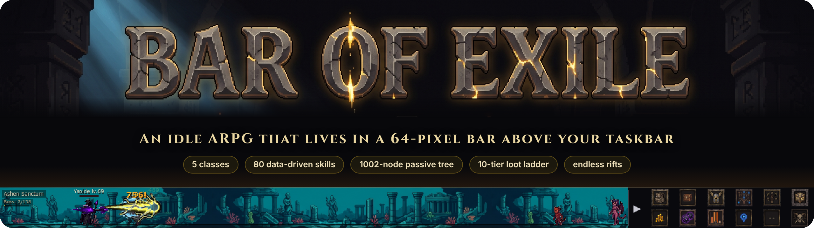
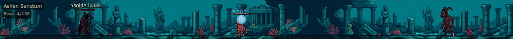
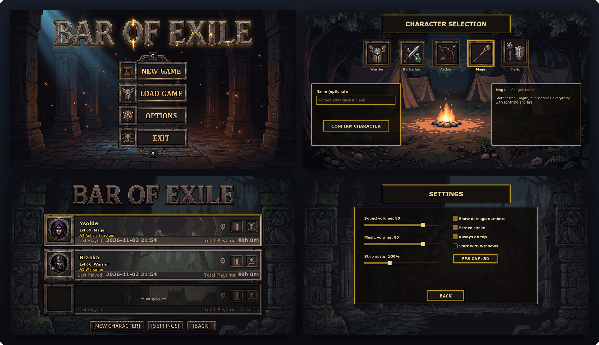
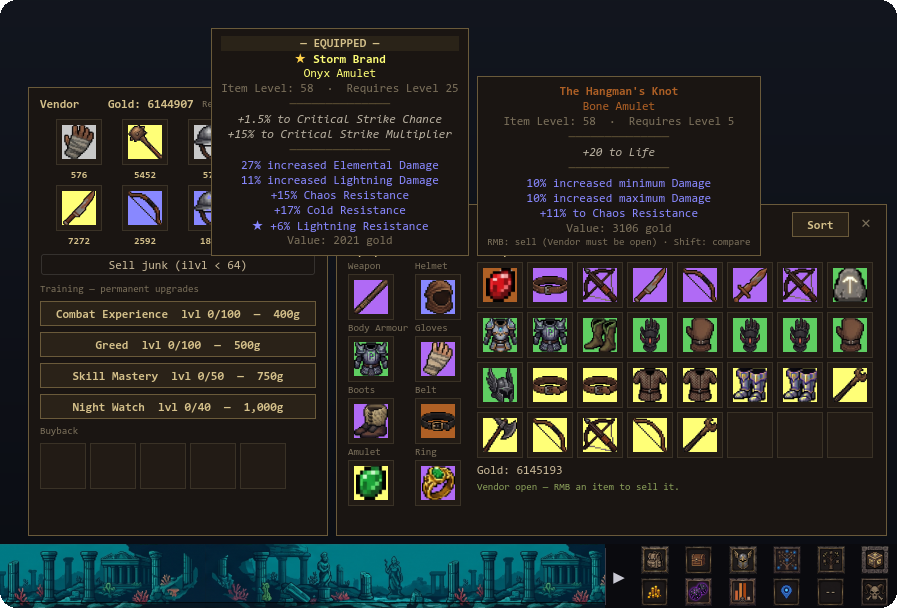
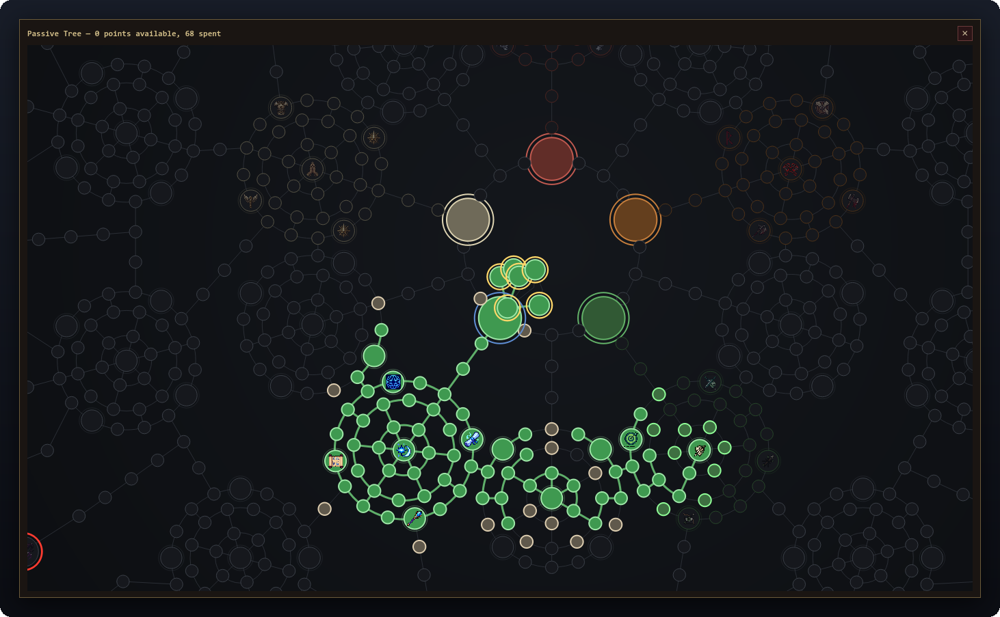
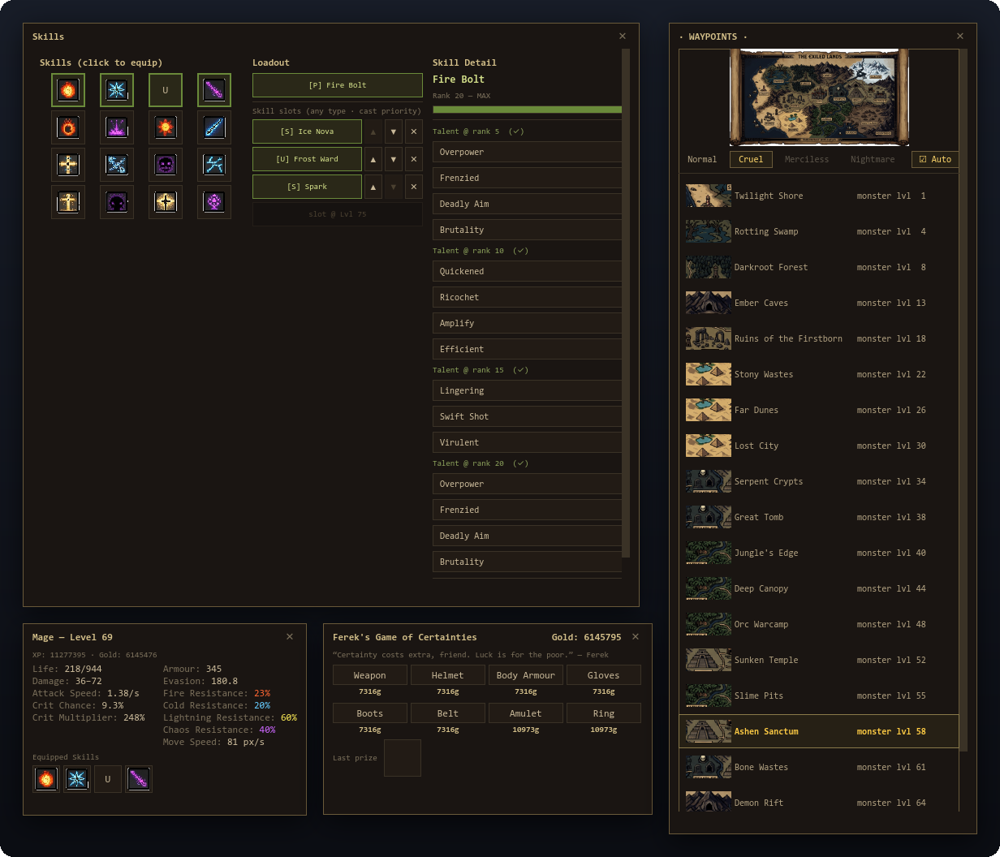
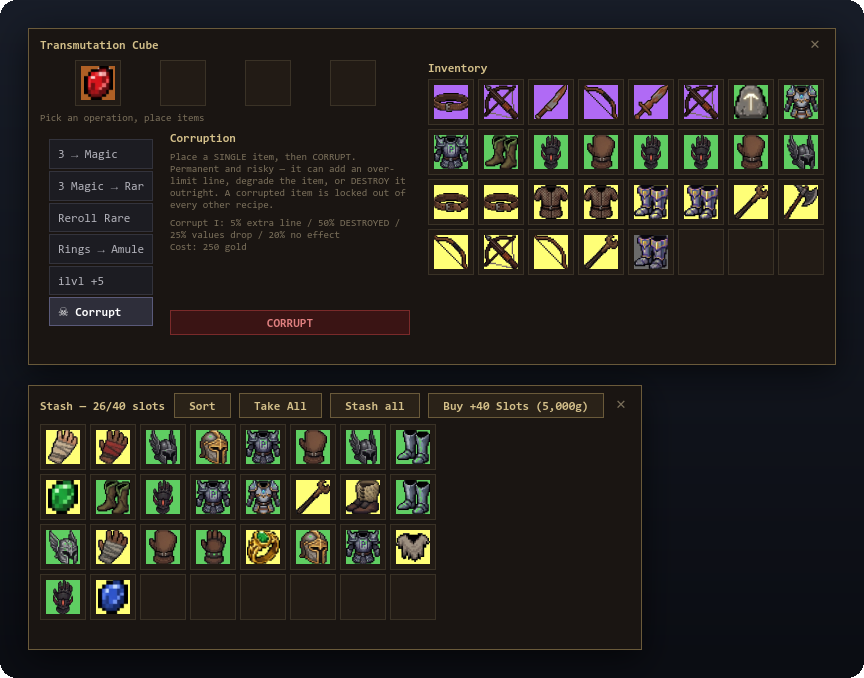

<div align="center">



<br><br>

[](#-quick-start)
[](https://pypi.org/project/PyQt6/)
[](#-quick-start)
[](https://github.com/Raindess69/Bar-of-exile/actions/workflows/tests.yml)
[](LICENSE)

**[Screenshots](#-screenshots) · [What's inside](#-whats-inside) · [Quick start](#-quick-start) · [Build .exe](#-building-a-standalone-exe) · [Tests](#-tests) · [Layout](#-project-layout) · [Full reference](#-full-reference)**

</div>

---

> **An idle ARPG that lives in a thin bar above your Windows taskbar.** Runs in the background, but under the hood it's a full hack-and-slash with PoE / Diablo 2 depth.

<p align="center">
  
  <br>
  <sub>The bar at <b>actual size</b>: a level-69 Mage clearing Ashen Sanctum (Act 3, Cruel). Blue outlines mark Magic mobs.</sub>
</p>

The format nods to *The Boring Hero* and tap-idle games: a narrow ~64px strip pinned above the taskbar. Behind the auto-combat: 5 classes, 80 data-driven skills, a 1002-node passive tree, 4 acts, a corruption-enabled crafting cube, a 10-tier rarity ladder, and endless endgame rifts.

**Stack:** Python 3.11+ · PyQt6 · Windows

---

## 📸 Screenshots

<p align="center">
  
  <br>
  <sub><b>Launcher</b>: main menu · character selection · per-hero save slots (level, zone, playtime) · settings.</sub>
</p>

<p align="center">
  
  <br>
  <sub><b>Loot &amp; trading.</b> Panels pop up above the bar; the 6×2 menu grid sits at its right end. Hover an item to see its card, hold <kbd>Shift</kbd> to compare it with what you wear (★ marks a Greater Affix).</sub>
</p>

<p align="center">
  
  <br>
  <sub><b>Passive tree</b>: one 1002-node canvas for every class (this Mage has 68 points spent). Click your class orb to unfold its ascendancy.</sub>
</p>

<p align="center">
  
  <br>
  <sub><b>Skills V2</b> loadout with ranks and talents · <b>character sheet</b> · <b>Ferek's Game of Certainties</b> · <b>Waypoints</b> with difficulty tabs and idle auto-advance.</sub>
</p>

<p align="center">
  
  <br>
  <sub><b>Vessara's Cube</b> on the ☠ Corruption tab, with odds and cost shown before you commit · <b>stash</b> tab (40 slots, up to 10 tabs).</sub>
</p>

> [!NOTE]
> Every image above is a real capture of the game's own UI: PyQt6 rendering offscreen at 1920×1080, using heroes that the bundled balance harness ([`tools/sim.py`](tools/sim.py)) played for 40 simulated hours. The game opens the panels in the last two images one at a time, so those two are collages.

---

## ✨ What's inside

### Classes (5)
| Class | Role | Signature |
|---|---|---|
| **Warrior** | Sword + shield | Cleave hits up to 4 mobs |
| **Barbarian** | Berserker | Crit, blood, fury |
| **Cleric** | Support / heal | Auras, holy skills, holy damage |
| **Archer** | Ranged | 260px range, evasion |
| **Mage** | Caster | Elements, AoE, cast speed |

### Skills V2 (80 total)
- Fully data-driven — everything lives in `data/skills_v2.json`; skill IDs are frozen for save compatibility.
- **Shared loadout pool:** 1 primary + 4 slots that unlock at levels **1 / 25 / 50 / 75**. Aura, active, utility, and ultimate all compete for the same slots — choice actually matters.
- Ranks 1–20 (25 with Awakening), talents (offense / defense / utility), ultimates with a one-shot burst.
- **Damage formula:** `(base + Σflat) × (1 + Σinc/100) × Π(1 + more/100)`
- 6 ailments: ignite / bleed / poison / freeze / shock / stun.

### Passive tree (1002 nodes)
- Single shared canvas for every class, with rendered edge arcs.
- **Ascendancy sub-trees** unfold when you click your class's own orb on the tree (PoE-Ascendancy style). 4 classes × 7 nodes + Mage 9.
- **Class Points** drop from act bosses and are spendable only on your own sub-tree.
- The tree can be rebuilt freely — broken or wrong-class nodes are refunded on load.

### World and progression
- **4 acts × ~5 zones each**, final bosses: `Vessara → Ferek → Vharos → Lord of Ash`.
- **Difficulty gate:** Normal → Cruel → Merciless → Nightmare — unlocked only by killing the final boss of the previous tier.
- **Uncapped leveling** past 100 (+1 tree point per level).
- **XP curve:** `60·(L-1)^2.6 · 1.05^(L-1)` — path to level 100 is ≈168 real-time hours (idle-paced).
- **Kills-to-boss** scale by act: Act 1 = 24–36, Act 4 = 98–147.

### Loot — 10-tier rarity ladder
| Tier | Affixes | Notes |
|---|---|---|
| Scrap | 0 | Salvage fodder |
| Normal | 0 | — |
| Magic | 1–2 | — |
| **Rare** | 3–6 (weights 40/35/18/7) | Main target |
| Exalted | 4–6, floor tier 3 | + implicit, ilvl ≥ 30 |
| Set | fixed | 2/3/4-piece bonuses |
| Unique | fixed | Handcrafted |
| Mythic | fixed_uber | Only from act boss / rift boss |
| **Relic** (modifier) | +1 rare affix, ×1.15–1.30 rolls | Holo-foil frame |
| **Primal** (modifier) | all rolls = max | Rainbow frame, ★ floor 3 |

Plus a **★ Greater Affix system** (D4-style): 1★ 6.5% / 2★ 2% / 3★ 0.4% / 4★ 0.05%. Punches through the tier cap and survives cube rerolls.

### Mob rarity (3 tiers)
- **Common** 85% · **Magic** 12% (blue outline, ×2 XP/gold) · **Rare** 3% (yellow outline, ×5 XP/gold, guaranteed drop + Magic rarity floor).

### Cube (Vessara's Cube)
5 recipes + **Corruption** (☠):
- Upgrade rarity, ilvl_up, Reroll Magic, Reroll Rare, 3 → Magic
- **Corruption I / II / III** — success rate from `white 50% → unique 5%`. A corrupted item is locked out of every other cube recipe (anti-exploit). Two-step "ARE YOU SURE?" confirmation.

### Gambling (Ferek's Game of Certainties)
- Pity: **0.006** base / soft cap on roll #73 (+12% per roll) / **hard cap 100% on #80**. No drop-only uniques.

### Economy (idle-friendly)
- **Offline progress** with tier decay: first 8h at 60%, 8–24h at 35%, 24–72h at 15%; away-time beyond 72h earns nothing extra (no level cap on offline gains).
- **Snapshot rates** — offline gold/XP is computed from the actual rates of your last session.
- **Training upgrades** at the vendor (gold sinks for +XP / +gold / +skill XP / +offline efficiency, ~50M total).
- **Stash: 40 slots × 10 tabs** — the main endgame gold sink (~220M to unlock the last tab).

### Endgame — Rifts
- Unlock after killing Lord of Ash.
- **Tier climbs** with each rift boss kill, drops one on 3 consecutive deaths (`rift.on_death`).
- Forced zone mods, ilvl floor 71, unique pity ×1.5, gold ×(1 + 0.06 × tier).

---

## 🚀 Quick start

```bash
pip install -r requirements.txt
python main.py
```

Requires **Python 3.11+**. Made for **Windows**: the bar docks right above the taskbar, using the
screen's available area as reported by Qt. Nothing in the code is Win32-only, so the same UI also
runs on Linux, which is how the screenshots above were rendered.

## 📦 Building a standalone .exe

Via PyInstaller (spec included, assets are bundled):

```bash
python -m PyInstaller bar_of_exile.spec --noconfirm
```

Output: `dist/BarOfExile/BarOfExile.exe` + `_internal/` with all assets and data. Saves are written next to the `.exe`, so player progress survives rebuilds.

## 🧪 Tests

```bash
python -m pytest -q               # full suite (~220 tests)
python tests/test_skills_v2.py    # single file
```

The suite needs no display: Qt tests run with `QT_QPA_PLATFORM=offscreen`
(set automatically where needed). On a headless **Linux** box PyQt6 also needs
the system GL/EGL libraries (`libgl1 libegl1 libxkbcommon0` on Debian/Ubuntu,
`mesa-libGL mesa-libEGL` on Fedora/Amazon Linux); without them every Qt test
fails at import with `libGL.so.1: cannot open shared object file`.

CI (`.github/workflows/tests.yml`) runs the full suite on Windows, the game's
target platform, for every push to `main` and every pull request. It checks out
code only (not the ~290 MB `assets/` folder), so runs stay fast.

Balance harness: `python tools/sim.py --class warrior --hours 4 --offline 8`
simulates online farming followed by an away session.

---

## 🗂 Project layout

```
bar-of-exile/
├── main.py                  # game loop, wires everything together
├── game/                    # pure logic (no Qt)
│   ├── core.py              # Stats, Item, Hero, Monster, Rarity, ...
│   ├── combat.py            # tick-based combat, auto-attack, cleave, projectiles
│   ├── combat_math.py       # shared combat primitives (crit / leech / kill hooks)
│   ├── skills_v2.py         # data-driven engine for all 80 skills
│   ├── ailments.py          # 6 ailments (ignite / bleed / poison / freeze / shock / stun)
│   ├── tree.py              # passive tree (1002 nodes + ascendancy)
│   ├── classes.py           # 5 classes, base stats + growth
│   ├── world.py             # zones, MonsterTemplate, Spawner, zone_mods
│   ├── progression.py       # XP curve, difficulty gate, uncapped leveling
│   ├── loot.py              # drop tables, boss drops, rare guaranteed drops
│   ├── item_roller.py       # affix roller + 10-tier ladder
│   ├── greater_affix.py     # ★ greater-affix system
│   ├── mob_rarity.py        # 3-tier mob rarity (common / magic / rare)
│   ├── uniques.py           # 29 uniques with special effects
│   ├── sets.py              # set items, bonuses
│   ├── mythics.py           # mythic tier
│   ├── cube.py              # cube crafting + corruption
│   ├── rifts.py             # endgame loop
│   ├── tomes.py             # skill tomes (unlock / skill XP)
│   ├── vendor.py            # vendor + Training upgrades
│   ├── gamble.py            # Ferek's Game of Certainties + pity
│   ├── stash_tabs.py        # 10-tab stash
│   ├── idle_upgrades.py     # E.1 gold sinks
│   ├── economy.py           # prices, valuation, offline gold-rate
│   ├── save.py              # SAVE_VERSION=5, migrations, offline progress
│   ├── statmap.py           # stat-id → StatMod bridge (data ↔ engine)
│   ├── stats_track.py       # tracker (kills, boss kills, deaths)
│   └── zone_mods.py         # auto zone mods (danger → reward)
├── ui/                      # PyQt6
│   ├── window.py            # the bar above the taskbar (GRID 6+6)
│   ├── render.py            # SpriteStore, VFX player, HP bars, damage numbers
│   ├── panels.py            # Inventory / Character / tooltips / RMB-sell
│   ├── skills_panel.py      # skills V2 panel (grid-16 / loadout / ranks)
│   ├── tree_panel.py        # tree — pan/zoom, arc edges, ascendancy expand
│   ├── launcher.py          # 1376×768 menu (Main / NewChar / Load / Settings)
│   ├── cube_panel.py        # cube — vertical tabs per recipe
│   ├── vendor_panel.py      # vendor + Training tab
│   ├── gamble_panel.py      # gamble + pity bar
│   ├── stash_panel.py       # 10-tab stash
│   ├── stats_panel.py       # statistics
│   ├── zones_panel.py       # zones + rift row after unlock
│   └── rarity_frames.py     # frames: holo-foil (Relic) / rainbow (Primal)
├── data/*.json              # data: skills / passives / affixes / zone mods
├── assets/                  # sprites (~70 mobs), VFX, icons, backgrounds, UI kit
├── tools/                   # asset converters, data generators, sim harness
├── tests/                   # ~220 unit tests
├── docs/GAME_BIBLE.md       # FULL reference: mechanics / lore / architecture
└── bar_of_exile.spec        # PyInstaller — onedir, windowed, assets bundled
```

---

## 📖 Full reference

Everything that didn't fit in the README — mechanics deep dive, every one of the 80 skills, the tree, lore, history, gotchas — is in **[docs/GAME_BIBLE.md](docs/GAME_BIBLE.md)** *(written in Russian — the dev's working language)*.

## 🎨 Credits

Art assets are a mix of open-source pixel-art packs and AI-generated content. Every sprite is normalized to a single style through `tools/convert_anim.py` (union-bbox slicing from bottom-center — zero jitter across animations).

## 📝 Changelog

**README & sim fix (Nov 2026)**
- New README with a banner, a gameplay GIF and screenshots, all captured from the game's own UI.
- **Fixed `tools/sim.py` equipping other classes' gear.** The harness ignored `class_req`, so
  simulated heroes wore items the game won't let them equip. The seed-11 Mage was wielding an
  Archer-only bow. The sim now applies the same rule as the inventory (`ui.panels.can_equip`).
  In a 40 h seed-11 run the Mage now finishes at level 69 on Cruel instead of level 80 on
  Merciless, so re-check any balance numbers taken from earlier sim runs. Covered by
  `tests/test_sim_harness.py`.

**Durability & tooling pass (Nov 2026)**
- **Save files survive crashes.** `save_game` now `fsync`s the new save before
  atomically swapping it in. Previously a power loss / BSOD right after an
  autosave could leave a zero-length slot file, and the hero would silently
  disappear from the load screen.
- **Automatic backup + recovery.** The previous *valid* save is kept as
  `<slot>.json.bak`; if the main file is ever corrupt, `load_game` restores from
  it. A corrupt main file is never rotated over a good backup. Cost: ~6 ms per
  autosave on a worst-case 428 KB save. Covered by `tests/test_save_durability.py`.
- **Fixed `tools/sim.py --offline`.** It was silently ignored: the harness
  passed `saved_at=0.0`, which `offline_progress` read as ~56 years away, so
  every offline-balance run reported the same capped result regardless of the
  requested hours.
- Removed dead code and unused imports; kept intentional re-exports explicit.
- Added Windows CI.

## 📄 License

MIT — see [LICENSE](LICENSE).
